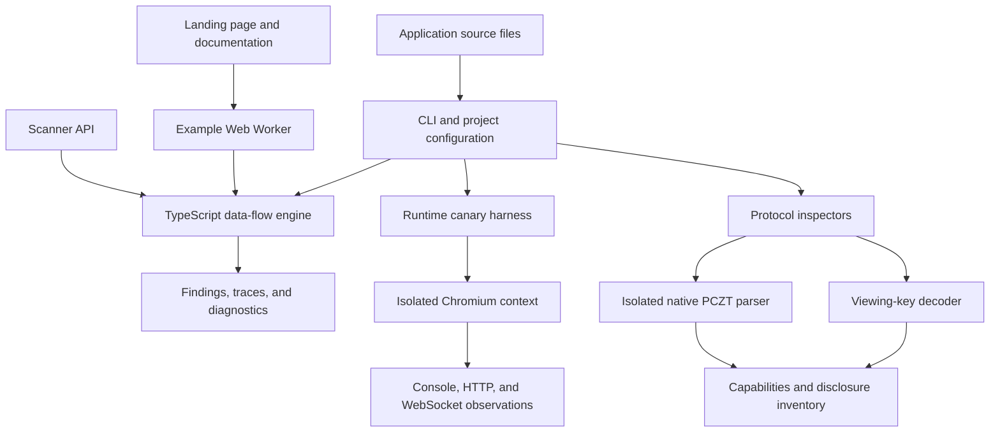

<p align="center">
  
</p>

<h1 align="center">ZTrace</h1>

<p align="center">
  <strong>Keep private wallet data out of public places.</strong>
</p>

<p align="center">
  Local privacy analysis for applications built on Zcash.<br />
  Trace sensitive data through your code, exercise application flows, and inspect Zcash disclosures.
</p>

<p align="center">
  <a href="#getting-started">Getting started</a> ·
  <a href="#architecture">Architecture</a> ·
  <a href="#cli-reference">CLI reference</a> ·
  <a href="#api-reference">API reference</a> ·
  <a href="#documentation">Documentation</a>
</p>

<p align="center">
  
  
  
  
  <br />
  
  
  
  
</p>

---

## Contents

- [Overview](#overview)
- [Architecture](#architecture)
- [Technology stack](#technology-stack)
- [Getting started](#getting-started)
- [Static analysis](#static-analysis)
- [Configuration](#configuration)
- [CLI reference](#cli-reference)
- [API reference](#api-reference)
- [Runtime testing](#runtime-testing)
- [Zcash disclosure inspection](#zcash-disclosure-inspection)
- [Validation](#validation)
- [Development commands](#development-commands)
- [Repository structure](#repository-structure)
- [Documentation](#documentation)
- [Data handling](#data-handling)
- [Contributing](#contributing)
- [Third-party notices](#third-party-notices)

## Overview

ZTrace helps developers inspect the privacy boundary between a Zcash wallet and the application using it. It tracks supported wallet data into logging, analytics, and network destinations, with source locations and trace steps that make findings actionable.

| Capability | What it provides |
| --- | --- |
| **Static analysis** | TypeScript-based data-flow analysis across local JavaScript and TypeScript modules, with supported React, SDK, and transport models. |
| **Browser runtime testing** | Synthetic canary observations across console output, HTTP requests, and WebSocket messages in an isolated Chromium context. |
| **Viewing-key inspection** | Revision-0 UFVK/UIVK encoding checks, component inventories, and full/incoming viewing-capability descriptions. |
| **PCZT disclosure inspection** | A private-field inventory from the native parser's signer projection, with recipient-role decisions. |
| **Reusable APIs** | Exported scanner, runtime, and protocol entry points for local integrations and test automation. |
| **Developer website** | A responsive landing page, integrated documentation, and a browser-worker example running the analysis engine. |

Findings cover shielded addresses, wallet accounts, balances, transaction history, viewing keys, spending keys, memos, and private transaction construction data. The [coverage reference](docs/SCANNER.md) describes supported APIs and language constructs; the [threat model](docs/THREAT-MODEL.md) defines the analysis boundary.

## Architecture

The core analysis engine accepts source text and returns a structured report. The CLI supplies filesystem discovery and project configuration. Browser examples run the same engine in a Web Worker. Runtime and protocol inspection are separate modules with their own reports.



| Module | Responsibility | Entry point |
| --- | --- | --- |
| `packages/core` | Source models, data-flow analysis, findings, and disclosure policies | `ztrace/scanner` |
| `packages/cli` | Commands, source discovery, JSON configuration, and tsconfig aliases | `ztrace` binary |
| `packages/runtime` | Browser resolution, synthetic canaries, actions, and network interception | `ztrace/runtime` |
| `packages/protocol` | Viewing-key decoding, native PCZT isolation, and disclosure decisions | `ztrace/protocol` |
| `src` | Product website, documentation renderer, and example worker | Vite application |

## Technology stack

| Layer | Technology |
| --- | --- |
| Language and analysis | TypeScript 6 and the TypeScript compiler API |
| Runtime | Node.js 24+ with ECMAScript modules |
| Frontend | React 19, Vite 8, and Tailwind CSS 4 |
| Motion and icons | Motion 14 and Lucide React |
| Documentation | React Markdown and remark-gfm |
| Browser automation | Playwright Core 1.64 and Chromium |
| Encoding and hashing | `@scure/base` 2.4 and `@noble/hashes` 2.0 |
| Native PCZT parsing | Optional `@ledgerhq/zcash-utils` 2.8.0 |
| Verification | Node.js test runner, axe-core Playwright, and Oxlint |
| Typography | Self-hosted Space Grotesk, Inter, and IBM Plex Mono |

Dependency versions are recorded in [package.json](package.json) and [package-lock.json](package-lock.json).

## Getting started

### Requirements

- **Node.js 24 or later** and npm.
- **Git** to clone the repository.
- **Chromium** for browser runtime and UI tests. The harness can use an existing Playwright installation or an executable supplied through `ZTRACE_BROWSER_PATH`.
- The optional Ledger utility package for native PCZT inspection.

### Install

```sh
git clone https://github.com/ELLA0VICTOR/ztrace.git
cd ztrace
npm ci
npm run build:tools
```

Commands in this README run from the repository root. On Windows PowerShell, use `npm.cmd` when the `npm.ps1` shim is blocked by your execution policy.

### Run your first scan

```sh
npm run scan -- examples/vulnerable
npm run scan -- examples/safe
```

The vulnerable example produces three findings across two files: a shielded address passed to analytics, a logged balance, and transaction history sent to a support endpoint. Its exit code is `1`. The corrected example produces zero findings and exits with `0`.

### Open the website and documentation

```sh
npm run dev
```

Open the localhost URL printed by Vite. The documentation is available at `/#docs/introduction`. The landing-page example includes leaking and corrected fixtures; **Run local check** analyzes the selected fixture in a browser worker.

### Create a production build

```sh
npm run build
npm run preview
```

The build prepares frontend example data, type-checks the application, and writes the website to `dist/`. The compiled CLI and APIs are written to `dist-tools/`.

## Static analysis

### Scan an application

```sh
npm run scan -- ../your-zcash-app
```

For automation, invoke the compiled CLI directly:

```sh
node dist-tools/packages/cli/src/cli.js scan ../your-zcash-app --format json --output privacy-report.json
```

A finding contains its rule, data category, severity, sensitive source, destination, intermediate trace steps, and remediation guidance. Reports also include review diagnostics and a coverage summary.

### Detection rules

| Rule | Destination | Default severity |
| --- | --- | --- |
| `ZT001` | Supported console and structured logging methods | Error |
| `ZT002` | Supported network requests and transport sends | Warning; viewing-key and spending-key disclosures are errors |
| `ZT003` | Supported analytics and error-reporting calls | Error |

Built-in integrations include selected Noir wallet SDK methods, the injected Noir provider, RHEA wallet adapter hooks and clients, and Ledger utility outputs. Destination models include console methods, selected Pino/Winston methods, Fetch, Beacon, Axios, XHR, WebSocket, PostHog, Segment, and Sentry.

Supported flows include local ES-module imports, functions, async values, object and array fields, destructuring, aliases, conditional joins, bounded loops, local classes, selected React hooks, JSX handlers, and JSON round trips.

### Project discovery

The CLI reads supported JavaScript and TypeScript extensions, including JSX/TSX and module variants. It loads local JSON/JSONC tsconfig path metadata, extends, and project references. Explicit `moduleAliases` can describe custom layouts.

Default discovery skips dependency/build directories, declaration files, and directory-entry symlinks. Use the configuration's `exclude` list for project-specific exclusions. Discovery limits are 1,000 files, 1 MB per file, and 20 MB total; skipped inputs are reported through coverage diagnostics.

See [scanner coverage and configuration](docs/SCANNER.md) for the complete integration reference and review behavior.

## Configuration

Place `ztrace.config.json` at the root of the application being scanned, or pass a policy with `--config`.

```json
{
  "sources": [
    {
      "module": "my-wallet-client",
      "export": "readAccount",
      "kind": "shielded-address",
      "path": "addresses.shielded"
    }
  ],
  "sinks": [
    {
      "module": "custom-telemetry",
      "export": "default.publish",
      "kind": "analytics"
    }
  ],
  "disclosurePolicies": [
    {
      "origin": "https://payments.example",
      "pathname": "/invoice",
      "kinds": ["shielded-address"],
      "fields": ["body.recipient"],
      "reason": "The invoice endpoint requires the recipient address."
    }
  ],
  "moduleAliases": {
    "@/*": ["src/*"]
  },
  "exclude": ["**/*.test.ts", "generated/**"],
  "maxSteps": 100000
}
```

- **Sources** describe the sensitive result of an imported function. The optional `path` selects a returned field.
- **Sinks** describe imported logging, network, or analytics functions and client methods.
- **Disclosure policies** match an exact HTTPS origin, pathname, data category, and payload field. Viewing and spending keys continue to produce errors.
- **Module aliases** resolve local imports relative to the scanned project.
- **Exclusions** use Node.js glob matching. Configure them explicitly for generated or unrelated source.

Configuration uses JSON and is read as data. See [configuration details](docs/SCANNER.md#json-configuration) for supported categories, field paths, and adapter matching.

## CLI reference

After `npm run build:tools`, run commands through `node dist-tools/packages/cli/src/cli.js`.

```text
ztrace scan [path] [options]
ztrace runtime <local-test-spec.json> [--output new-report.json]
ztrace inspect key <local-file> [--output new-report.json]
ztrace inspect pczt <local-file> --recipient <role> [--acknowledge-private-disclosure] [--output new-report.json]
```

### Scanner options

| Option | Behavior |
| --- | --- |
| `--format text\|json` | Select human-readable or structured output; default is `text`. |
| `--output <file>` | Create a new report file. |
| `--config <file>` | Load a JSON configuration file. |
| `--fail-on warning\|error\|never` | Select the finding threshold; default is `warning`. |
| `--help` | Print command usage. |
| `--version` | Print the package version. |

### Scanner exit codes

| Code | Meaning |
| --- | --- |
| `0` | Analysis completed with no findings at the selected threshold. |
| `1` | Findings meet the selected threshold. |
| `2` | Invalid input, incomplete coverage, or an execution error. |

`--fail-on never` keeps findings informational while preserving incomplete-coverage failures. Output files use exclusive creation; choose a fresh filename for each report.

### CI integration

Run the built scanner in a job with access to the ZTrace checkout and the target application's source. Preserve the scanner's exit status and retain its JSON report as a job artifact.

```sh
npm ci
npm run build:tools
node dist-tools/packages/cli/src/cli.js scan ../application --format json --output privacy-report.json
```

The [CLI guide](docs/CLI.md) includes local integration details.

## API reference

The built repository exposes three package entry points:

| Import | Exports |
| --- | --- |
| `ztrace/scanner` | `scanSources`, `sensitiveKinds`, and scanner types |
| `ztrace/runtime` | `auditBrowser`, `findBrowserPath`, and runtime types |
| `ztrace/protocol` | `inspectViewingCapability`, `inspectPcztDisclosure`, and protocol types |

The following ESM examples run from the built repository through package self-reference. External applications can integrate the built package using a local package dependency.

### Analyze source text

```ts
import { scanSources } from 'ztrace/scanner'

const report = scanSources([
  {
    path: 'checkout.ts',
    content: `
      import { getNoirWallet } from '@noir-wallet/sdk'

      const accounts = await getNoirWallet().zcash.getAccounts()
      console.log(accounts.shielded)
    `,
  },
])

for (const finding of report.findings) {
  console.log(finding.ruleId, finding.sink, finding.remediation)
}

console.log(report.summary)
```

`scanSources(files, options?)` accepts `{ path, content }` records and returns a `ScanReport`. Options include source/sink adapters, disclosure policies, module aliases, and the analysis step budget. Supply project files and alias metadata through the API; the CLI handles their discovery automatically.

### Exercise a local application

```ts
import { auditBrowser } from 'ztrace/runtime'

const marker = 'ZTRACE_TEST_ADDRESS_8f16743ec07c4ba7'

const report = await auditBrowser({
  url: 'http://127.0.0.1:5173',
  canaries: [
    { name: 'customer_address', kind: 'shielded-address', value: marker, synthetic: true },
  ],
  testData: { address: marker },
  actions: [{ type: 'click', selector: '[data-test=checkout]' }],
  settleMs: 200,
})

console.log(report.findings, report.completion)
```

### Inspect local artifacts

```ts
import { readFile } from 'node:fs/promises'
import { inspectViewingCapability, inspectPcztDisclosure } from 'ztrace/protocol'

const key = (await readFile('./viewing-key.txt', 'utf8')).trim()
const capability = inspectViewingCapability(key)

const pczt = await readFile('./transaction.pczt')
const disclosure = await inspectPcztDisclosure(pczt, { recipient: 'support' })

console.log(capability, disclosure)
```

## Runtime testing

The runtime harness exercises a trusted HTTP(S) loopback application with supplied synthetic values. It creates a fresh Chromium context, injects test data before application scripts run, performs the configured actions, and records supported canary observations.

### Configure a test flow

Save a specification as `ztrace.runtime.json`:

```json
{
  "url": "http://127.0.0.1:5173",
  "canaries": [
    {
      "name": "customer_address",
      "kind": "shielded-address",
      "value": "ZTRACE_TEST_ADDRESS_8f16743ec07c4ba7",
      "synthetic": true
    }
  ],
  "testData": {
    "address": "ZTRACE_TEST_ADDRESS_8f16743ec07c4ba7"
  },
  "actions": [
    { "type": "click", "selector": "[data-test=checkout]" }
  ],
  "settleMs": 200
}
```

Wire the application under test to read the supplied data from `window.__ZTRACE_TEST_DATA__`. Supported actions are `click`, `fill`, and `waitFor`.

```sh
node dist-tools/packages/cli/src/cli.js runtime ./ztrace.runtime.json --output runtime-report.json
```

### Browser setup

Use an existing Playwright Chromium installation, pass `browserPath` through the API, or set the browser executable explicitly:

```powershell
$env:ZTRACE_BROWSER_PATH = 'C:\path\to\chrome.exe'
npm.cmd run test:runtime
```

```sh
ZTRACE_BROWSER_PATH=/path/to/chromium npm run test:runtime
```

The harness records the actual browser version. It observes supported plain, URL-encoded, base64/base64url, hexadecimal, and JSON-escaped representations in console arguments, HTTP URLs/headers/bodies, and WebSocket messages. External requests and upstream WebSocket connections are blocked; redirects produce an incomplete result. Bundle application test assets on the local origin.

Runtime exit codes are `0` for a completed flow without observed exposure, `1` for observed exposure, and `2` for an incomplete run. See the [runtime guide](docs/RUNTIME.md) for network behavior and observation scope.

## Zcash disclosure inspection

### Unified viewing capabilities

```sh
node dist-tools/packages/cli/src/cli.js inspect key ./viewing-key.txt
```

The revision-0 UFVK/UIVK decoder checks Bech32m checksum, inverse F4Jumble, network padding, canonical CompactSize fields, component ordering, and known lengths. Reports describe the network, full/incoming scope, known components, and their viewing capabilities. Key material is read from a local file.

### PCZT recipient roles

```sh
node dist-tools/packages/cli/src/cli.js inspect pczt ./transaction.pczt.hex --recipient support
```

PCZT inspection accepts binary or hex input. The optional native parser runs in an isolated child process with a timeout and memory limit, returning a signer-projection field inventory and recipient-role decision.

| Recipient | Decision for a parsed private construction artifact |
| --- | --- |
| `support`, `analytics`, `broadcast` | Reject disclosure. |
| `prover`, `signer` | Require explicit acknowledgment of private disclosure. |

```sh
node dist-tools/packages/cli/src/cli.js inspect pczt ./transaction.pczt.hex --recipient prover --acknowledge-private-disclosure
```

Structural viewing-key checks and PCZT signer-projection inventories have separate coverage boundaries. See the [protocol reference](docs/PROTOCOL.md) for supported encodings, fields, and role semantics.

## Validation

### Scanner benchmark

The repository includes a fixed, self-authored synthetic corpus of 60 programs: 30 leaking cases and 30 safe cases, organized into regression, integration, and challenge splits.

| Configuration | Detected leaks | Missed leaks | Safe cases flagged | Safe cases clear |
| --- | ---: | ---: | ---: | ---: |
| Built-in models | 28 | 2 | 0 | 30 |
| With two explicit custom-library adapters | 30 | 0 | 0 | 30 |

Results are case-level measurements for this corpus. Reports retain fixture classifications, review diagnostics, timings, and SHA-256 hashes for the corpus, evaluator, and engine.

```sh
npm run benchmark
```

Read the [benchmark report](benchmarks/latest.md) and [methodology](benchmarks/METHODOLOGY.md).

### Browser and protocol checks

- **Runtime integration:** five controlled flows cover a leak, its correction, WebSockets, request headers, and redirects. Reports are retained in [runtime/evidence/latest.json](runtime/evidence/latest.json).
- **Protocol vectors:** eight upstream F4Jumble cases and 40 upstream viewing-key encodings, with pinned provenance and hashes.
- **PCZT fixture:** a locally generated synthetic V6 construction artifact with recorded provenance.
- **Website checks:** desktop/mobile navigation, keyboard interactions, clipboard actions, real worker analysis, scroll behavior, and automated accessibility checks.

```sh
npm test
npm run benchmark
npm run test:runtime
npm run test:ui
npm run lint
```

## Development commands

| Command | Purpose |
| --- | --- |
| `npm run dev` | Prepare example data and start the Vite development server. |
| `npm run build` | Build tools, prepare frontend data, type-check, and build the website. |
| `npm run preview` | Serve the production website locally. |
| `npm run build:tools` | Compile the CLI and reusable packages into `dist-tools/`. |
| `npm run prepare:ui` | Build tools and generate browser fixture reports and validation counts. |
| `npm run scan -- <path>` | Build tools and scan an application. |
| `npm test` | Run the core, application-coverage, CLI, and protocol suites. |
| `npm run benchmark` | Evaluate the fixed corpus and check regression/integration expectations. |
| `npm run test:runtime` | Run the Chromium canary integration tests. |
| `npm run test:ui` | Build and verify the production website in Chromium. |
| `npm run lint` | Check source with Oxlint. |

## Repository structure

```text
ztrace/
├── packages/
│   ├── core/src/              # Analysis engine, rules, types, and policies
│   ├── cli/src/               # Commands, discovery, and project resolution
│   ├── runtime/src/           # Chromium harness and canary observation
│   └── protocol/src/          # Viewing-key and PCZT disclosure inspection
├── src/
│   ├── components/            # Shared website components
│   ├── pages/                 # Landing page and documentation
│   ├── workers/               # Browser analysis worker
│   ├── generated/             # Fixture reports generated before dev/build
│   ├── App.tsx                # Site shell and navigation
│   └── index.css              # Base styles and self-hosted fonts
├── public/                    # Brand assets, fonts, and font licenses
├── docs/                      # Setup, API guides, coverage, and threat model
├── examples/
│   ├── vulnerable/            # Three-disclosure scanner fixture
│   └── safe/                  # Corrected scanner fixture
├── benchmarks/                # Corpus, evaluator, methodology, and reports
├── runtime/evidence/          # Retained browser-test evidence
├── tests/
│   ├── fixtures/protocol/     # Pinned upstream vectors and synthetic PCZT
│   ├── runtime/              # Runtime integration tests
│   └── ui/                   # Production website smoke tests
├── scripts/                   # Frontend data preparation
├── package.json               # Commands and package exports
└── vite.config.ts             # React and Tailwind build configuration
```

`dist/`, `dist-tools/`, `src/generated/`, and `.artifacts/` are local build or test outputs covered by `.gitignore`. Preparation scripts recreate generated frontend data during development and production builds.

## Documentation

| Guide | Contents |
| --- | --- |
| [Introduction](docs/INTRODUCTION.md) | Product concepts and analysis modes |
| [Quickstart](docs/QUICKSTART.md) | Installation, example scans, and application setup |
| [CLI & integration](docs/CLI.md) | Commands, exit codes, CI, and local package integration |
| [Sources, adapters & policies](docs/SCANNER.md) | Supported APIs, language flows, adapters, and configuration |
| [Runtime testing](docs/RUNTIME.md) | Synthetic data, browser setup, actions, and network handling |
| [Disclosure inspection](docs/PROTOCOL.md) | Viewing capabilities, PCZT inventories, and recipient roles |
| [Benchmark methodology](benchmarks/METHODOLOGY.md) | Corpus structure, matching criteria, and evidence provenance |
| [Threat model](docs/THREAT-MODEL.md) | Trust boundaries and coverage scope |
| [Limitation audit](docs/LIMITATION-AUDIT.md) | Audited findings, improvements, and remaining coverage work |
| [Troubleshooting](docs/TROUBLESHOOTING.md) | Common setup, resolution, browser, and inspection issues |

## Data handling

Static analysis reads application source locally. Browser examples run fixture source in a worker, and runtime testing uses explicitly supplied synthetic canaries in a fresh browser context. Viewing keys and PCZT inputs are processed from local files.

Reports contain locations, categories, trace labels, destination context, and diagnostics. Treat them as project artifacts and review their contents before sharing. Detailed handling and coverage rules are documented in the [threat model](docs/THREAT-MODEL.md).

## Contributing

Use a focused change with an explanation of the affected behavior and relevant verification. For a new source, sink, or language-flow model, include a leaking example and its safe counterpart. Update the coverage documentation when the supported boundary changes.

Run `npm test`, `npm run benchmark`, and `npm run lint` for engine changes. Run the runtime or UI suite when changing those layers. Preserve protocol-vector provenance and intentionally review any corpus or fixture updates.

## Third-party notices

Zcash test vectors retain their upstream [MIT license](tests/fixtures/protocol/LICENSE-MIT) and [source provenance](tests/fixtures/protocol/PROVENANCE.json). Self-hosted fonts retain their SIL Open Font Licenses under [public/fonts](public/fonts). Dependency versions and attribution references are available through the package manifests and the protocol documentation.
